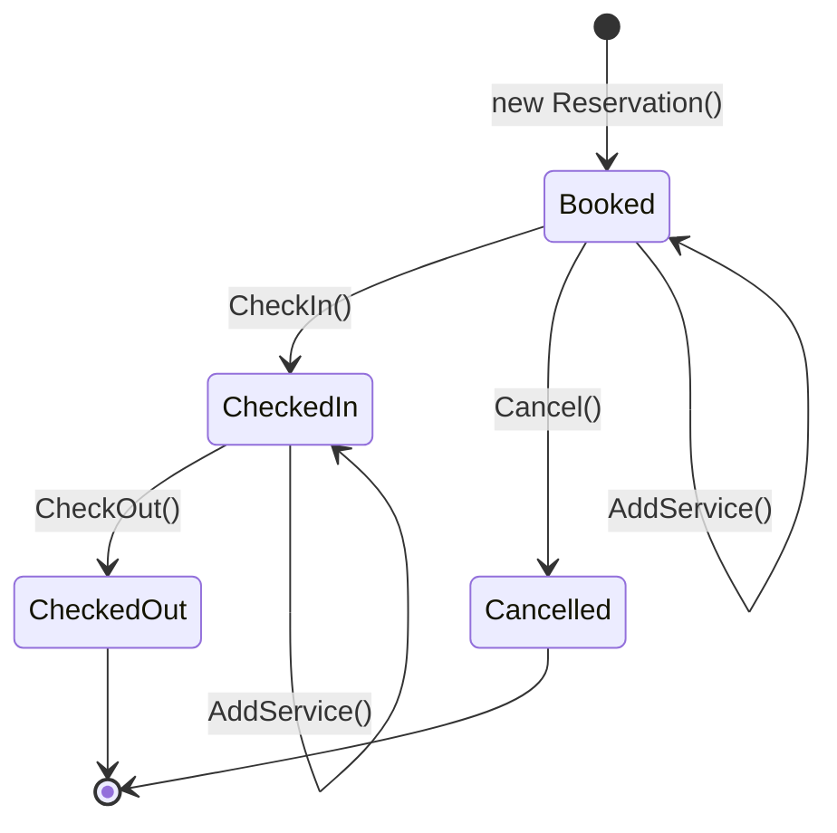

# 🏨 Đồ án OOP: Hotel Reservation System

Ứng dụng console quản lý đặt phòng khách sạn, viết bằng C# (.NET 10), áp dụng 4 nguyên lý hướng đối tượng: đóng gói, trừu tượng, kế thừa, đa hình.

- **Môn học:** Lập trình hướng đối tượng, HK1 2026-2027
- **GVHD:** Huỳnh Xuân Phụng

## 👥 Thông tin nhóm

| Thành viên | MSSV | Phần việc chính |
|---|---|---|
| Nguyễn Lê Hảo | 25110019 | `Reservation`, trạng thái đặt phòng, chống trùng lịch, `HotelManager` (tìm phòng trống) |
| Bùi Tấn Lộc | 25110037 | `Guest`, `Room`, tính tiền và hóa đơn, Console Menu, test |

## 🚀 Chức năng

Menu console gồm 7 chức năng:

1. Tìm phòng trống theo ngày check-in và check-out
2. Đặt phòng (nhập thông tin khách, chọn phòng, thêm dịch vụ)
3. Check-in
4. Check-out và in hóa đơn
5. Thêm dịch vụ vào một đặt phòng
6. Hủy đặt phòng
7. Xem danh sách đặt phòng

Dữ liệu mẫu khi khởi động: 4 phòng (101, 102 là Standard; 201, 202 là VIP) và một đặt phòng mẫu `R001` để thử ngay check-in, check-out.

## 💰 Quy tắc tính tiền

| Loại | Cách tính |
|---|---|
| Phòng Standard | Giá cơ bản mỗi đêm |
| Phòng VIP | Giá cơ bản cộng phí dịch vụ VIP 20% mỗi đêm |
| Ăn sáng | 100,000 VND mỗi người mỗi đêm |
| Giặt ủi | 150,000 VND cố định |
| Suối nước nóng và xông hơi | 100,000 VND mỗi người, gói một lần |
| Khu vui chơi sinh thái | Miễn phí cho mọi khách |

Phòng VIP được miễn phí ăn sáng, giặt ủi, suối nước nóng và xông hơi.

## 📂 Cấu trúc project

| File | Nội dung |
|---|---|
| `Room-information.cs` | `Guest`, `RoomType`, `Room` (abstract), `StandardRoom`, `VipRoom` |
| `Reservation.cs` | `ReservationStatus`, `Reservation` (đặt phòng và máy trạng thái) |
| `HotelManager.cs` | Quản lý phòng và đặt phòng, tìm phòng trống, chặn đặt trùng |
| `AddOnServices.cs` | `IAddOnService` và 4 dịch vụ: `BreakfastService`, `LaundryService`, `SpaService`, `EcoParkService` |
| `Billing.cs` | `InvoiceLine`, `Invoice`, `BillingService` (tính và in hóa đơn) |
| `Program.cs` | Console Menu và điểm khởi chạy |
| `Testrunner.cs` | 3 scenario kiểm thử tự động |

## ⚙️ Cách chạy

Yêu cầu: cài [.NET 10 SDK](https://dotnet.microsoft.com/download).

```bash
# Chạy chương trình
dotnet run

# Chạy bộ test (in PASS/FAIL cho từng kiểm tra)
dotnet run -- test
```

## 🧪 Kiểm thử

`Testrunner.cs` có 3 scenario chạy qua code thật:

1. **Happy path:** tìm phòng, đặt phòng, check-in, check-out, kiểm tra hóa đơn phòng Standard là 1,750,000 VND.
2. **Validation / error:** dữ liệu sai (tên khách rỗng, check-out không sau check-in), đặt trùng phòng, đặt phòng không tồn tại, thao tác sai trạng thái (check-out khi chưa check-in, check-in hai lần, hủy sau khi đã check-in), hủy đơn đang Booked thì phòng trống lại.
3. **Polymorphism:** giá đêm Standard 500,000 và VIP 1,440,000 qua cùng kiểu `Room`; cùng bộ dịch vụ, hóa đơn phòng VIP là 2,880,000 VND vì các dịch vụ được miễn phí.

## 🔄 State machine của Reservation



Mọi chuyển trạng thái không có trong sơ đồ đều ném `InvalidOperationException`. `AddService()` không đổi trạng thái và chỉ dùng được ở `Booked` và `CheckedIn`.

## 🧠 Áp dụng OOP

| Nguyên lý | Nơi áp dụng |
|---|---|
| Đóng gói | `Reservation.Status` và `TotalBill` có `private set`; `HotelManager` giữ danh sách private, chỉ lộ ra `IReadOnlyList` |
| Trừu tượng | `abstract class Room`, `interface IAddOnService` |
| Kế thừa | `StandardRoom` và `VipRoom` kế thừa `Room` |
| Đa hình | `CalculateNightlyRate()` được override ở hai lớp con; `BillingService` gọi `CalculateCost()` và `FreeForVip` qua `IAddOnService` |

Thêm dịch vụ mới chỉ cần thêm một class cài đặt `IAddOnService`, không phải sửa `BillingService`.

## 🤖 Sử dụng AI

Nhóm ghi lại việc dùng AI (Claude và Gemini) trong `AI_Usage_Log.md`.